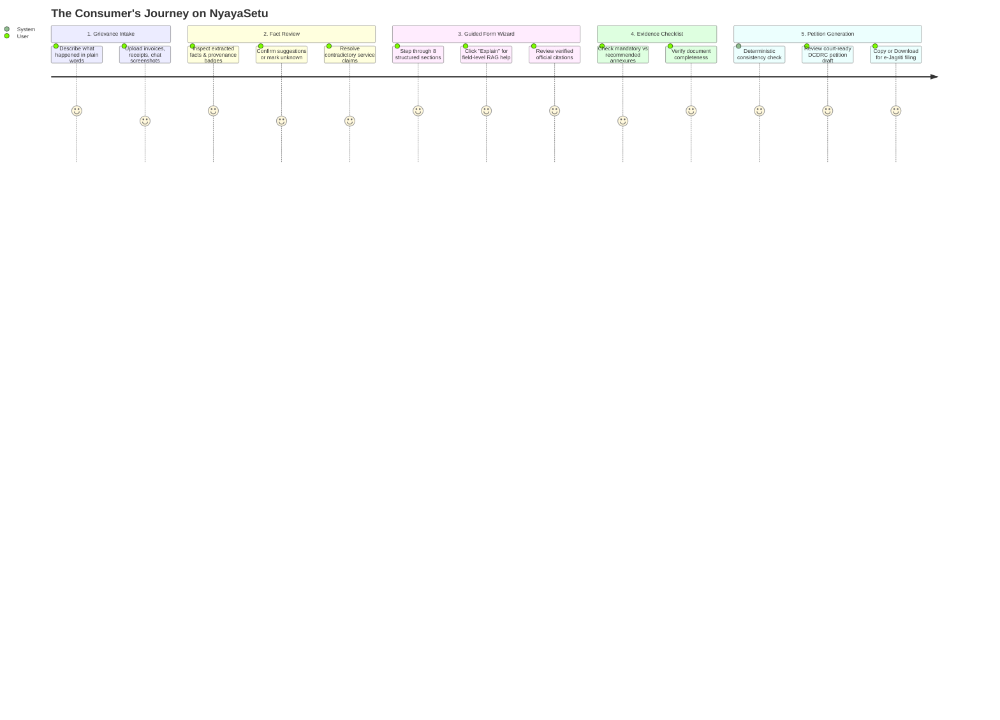
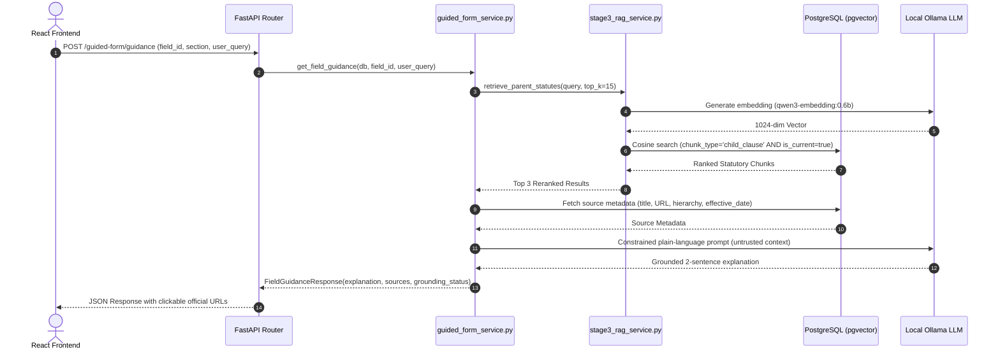

# ⚖️ NyayaSetu (न्यायसेतु) — Comprehensive Walkthrough
### End-to-End Guide for Litigants (User End) and Engineers/Architects (System Structure)

---

## 🧭 Executive Overview

**NyayaSetu** is an AI-powered legal document preparation system engineered specifically for Indian Consumer Protection Law under the **Consumer Protection Act, 2019 (CPA 2019)**, the **Consumer Protection (E-Commerce) Rules, 2020**, and the **Consumer Protection (Pecuniary Jurisdiction) Rules, 2021**.

The **Consumer Bridge** feature bridges the four critical gaps Indian consumers face when seeking justice:
1. **The Language Gap:** Translating emotional, informal narratives into legally sound factual pleadings.
2. **The Knowledge Gap:** Providing plain-language explanations of complex court fields grounded in real statutory gazettes.
3. **The Information Gap:** Proactively identifying missing mandatory proofs and resolving contradictory claims.
4. **The Preparation Gap:** Generating a court-ready, formally verified petition for filing before the District (DCDRC), State (SCDRC), or National (NCDRC) Consumer Commissions.

---

# 👤 Part 1: The User End Walkthrough (The Litigant Journey)



---

### Step 1: Grievance Intake & Evidence Drop

Consumers do not need to know legal terminology. The journey begins with an informal description:

1. **Describe the Problem in Everyday Language:**
   - Write in plain English, हिंदी (Hindi), or Hinglish (e.g. *"I bought a 55-inch Smart TV from Amazon for ₹54,999. After 2 months the screen went blank. The service centre technician visited and falsely claimed physical damage, refusing free warranty repair."*).
2. **Attach Supporting Files:**
   - Drop Tax Invoices, cash memos, warranty cards, technician job sheets, customer support emails, or photos of the defect.
3. **Privacy by Design:**
   - A clear trust banner assures the user that all document analysis and AI inference execute **strictly on local offline models**. No private invoices or grievance data are transmitted to third-party commercial clouds.

---

### Step 2: Fact Review & Provenance Badges

Unlike traditional chatbots that hallucinate or silently guess details, NyayaSetu presents every extracted fact with an explicit **Provenance Badge**:

| Badge | Meaning | Action Available |
|---|---|---|
| <span style="background:#e6f4ea; color:#137333; padding:2px 8px; border-radius:12px; font-weight:bold;">✓ Confirmed</span> | Verified and locked by the user. | Click `Edit` to revise anytime. |
| <span style="background:#fef7e0; color:#b06000; padding:2px 8px; border-radius:12px; font-weight:bold;">✦ Suggested</span> | Inferred by AI from grievance text or invoice; **not yet legally confirmed**. | Click `Confirm` or `Edit`. |
| <span style="background:#fce8e6; color:#c5221f; padding:2px 8px; border-radius:12px; font-weight:bold;">⚠ Missing</span> | Required by court rules but not found in user records. | Enter value or provide reason. |
| <span style="background:#fef0f0; color:#d93025; padding:2px 8px; border-radius:12px; font-weight:bold;">⚡ Contradiction</span> | Disagreement between consumer narrative and opposite party records. | Click `Resolve Contradiction`. |
| <span style="background:#f1f3f4; color:#5f6368; padding:2px 8px; border-radius:12px; font-weight:bold;">? Marked Unknown</span> | User explicitly does not possess this detail. | Safe: petition will safely cite placeholder. |

> [!IMPORTANT]
> **No Fake Identifiers:** If you do not have an invoice number or order ID, clicking **"Mark Unknown"** is completely safe. NyayaSetu will render: `Tax Invoice dated [Date] [Invoice number not specified in current records]` instead of making up a fake number.

---

### Step 3: The 8-Step Guided Complaint Wizard

The consumer steps through an 8-stage progress stepper:

1. **Section 1: Case Overview & Forum Jurisdiction**
   - Automatically determines whether the petition belongs to the **District Commission (DCDRC)**, **State Commission (SCDRC)**, or **National Commission (NCDRC)** based strictly on the purchase consideration paid.
2. **Section 2: Complainant Particulars**
   - Full legal name, residential address, email, and mobile number for official court summons.
3. **Section 3: Opposite Parties & Commercial Entities**
   - Separates distinct legal entities: Marketplace Intermediary (e.g. Amazon), Brand Manufacturer (e.g. Samsung), Registered Seller, and Authorized Service Center.
4. **Section 4: Transaction & Product Particulars**
   - Exact product model, invoice date, payment mode, and consideration paid in ₹ INR.
5. **Section 5: Incident Chronology & Dispute History**
   - Dates of defect discovery, service visits, and prior attempts at amicable resolution.
6. **Section 6: Statutory Grounds of Defect & Deficiency**
   - Grounds under Section 2(10) (*Defect in Goods*), Section 2(11) (*Deficiency in Service*), and Section 2(47) (*Unfair Trade Practice*).
7. **Section 7: Schedule of Claimed Relief (Section 39)**
   - Itemizes the refund of purchase consideration, compensation for mental agony, and reasonable litigation costs separately.
8. **Section 8: Evidence Annexures & Final Review**
   - Indexes all uploaded documents as Annexure A-1, A-2, etc., and conducts a final consistency audit.

---

### Step 4: Contextual RAG Legal Assistance ("Explain this Field")

Next to every form field is an **"Explain"** button:
- Clicking it opens the **Contextual Legal Grounding Drawer** on the right side.
- It provides a **plain-language explanation** of why the field is required under Indian law.
- It displays **real official citations** from the Consumer Protection Act, 2019 and e-Jagriti filing guidelines, including:
  - Document Title & Section (e.g. *Consumer Protection Act, 2019 — Chapter IV, Section 39(1)(c)*)
  - Direct official source URL (e.g. <https://consumeraffairs.gov.in/pages/consumer-protection-acts>)
  - Official Gazette Excerpt
- Consumers can type custom follow-up questions into the query bar to get immediate, grounded clarifications.

---

### Step 5: Resolving Contradictions Interactively

When opposing accounts conflict (e.g. *Technician job sheet alleges customer physical damage vs Consumer states internal motherboard failure*):
- The assistant displays a **Contradiction Alert**.
- Clicking **"Resolve Contradiction"** opens a dedicated modal presenting both sides.
- The consumer chooses whether to:
  1. Stand by their account (*Internal hardware failure during normal usage*).
  2. Plead the technician's claim as an unfounded and disputed allegation.
  3. Enter their own custom factual clarification.

---

### Step 6: Evidence Checklist & Court Petition Generation

Before drafting:
- The system reviews the **Documentary Evidence Checklist**, marking documents as *Mandatory Filing Instruction* (e.g. Tax Invoice, Notice to Seller) vs *Recommended Evidence* (e.g. Job Sheet, Defect Photos).
- A **Deterministic Consistency Check** ensures that amounts match, dates follow chronological order, and no required fields remain blank.
- The consumer clicks **"Generate Court-Ready Complaint Petition"**:
  - The local legal drafter formats a complete petition adhering to the official DCDRC court skeleton.
  - The petition is rendered in an editable paper document preview.
  - The consumer can **Copy** the full petition or **Download .TXT** for uploading directly to **e-Jagriti** (<https://e-jagriti.gov.in>).

---

# 🛠️ Part 2: The Architect & Developer Walkthrough (System Structure)

---

### 1. System Topology & Architecture

```mermaid
flowchart TD
    subgraph Frontend["React 18 + Vite Frontend (Soft Neumorphic UI)"]
        UI_INTAKE[Intake & Narrative Input]
        UI_WIZARD[Guided Form Wizard - 8 Stepper Steps]
        UI_PROV[Field With Provenance & Badges]
        UI_RAG[Contextual RAG Guidance Drawer]
        UI_EVID[Evidence Checklist Section]
        UI_CONF[Conflict Resolver Modal]
        UI_PREV[Court Document Preview & Download]
    end

    subgraph API["FastAPI REST Endpoints (nyaysetu_backend/api/v1/)"]
        EP_SUBMIT["POST /cases/submit"]
        EP_GET_FORM["GET /cases/{id}/guided-form"]
        EP_PATCH_FIELD["PATCH /cases/{id}/guided-form/fields/{fid}"]
        EP_GUIDE["POST /cases/{id}/guided-form/guidance"]
        EP_RESOLVE["POST /cases/{id}/guided-form/clarifications"]
        EP_VALIDATE["POST /cases/{id}/guided-form/validate"]
        EP_DRAFT["POST /cases/{id}/guided-form/draft"]
    end

    subgraph BackendServices["Core Application Services (nyaysetu_backend/services/)"]
        SVC_FACT[stage2_fact_service.py - Small LLM Fact Extraction]
        SVC_GUIDED[guided_form_service.py - Form State & Validation]
        SVC_RAG[stage3_rag_service.py - pgvector Cosine Retrieval]
        SVC_DRAFT[stage4_generator_service.py - Drafter LLM & Consistency Gate]
        SVC_TMPL[template_service.py - Jinja2 DCDRC Skeleton]
    end

    subgraph LocalInference["Local Offline Inference (Ollama)"]
        OLLAMA_FACT["qwen2.5:3B-instruct (Fact Extraction & Help Paraphrase)"]
        OLLAMA_EMBED["qwen3-embedding:0.6b (1024-dim Vector Search)"]
        OLLAMA_DRAFT["nyaysetu-drafter (Structured Legal Slots)"]
    end

    subgraph Storage["Persistent Database (PostgreSQL 16 + pgvector)"]
        DB_CASES[grievance_cases Table - Status, Facts, guided_form_state]
        DB_STATUTES[legal_statutes Table - CPA 2019, Rules, e-Jagriti Chunks]
    end

    UI_INTAKE --> EP_SUBMIT
    UI_WIZARD --> EP_GET_FORM
    UI_PROV --> EP_PATCH_FIELD
    UI_RAG --> EP_GUIDE
    UI_CONF --> EP_RESOLVE
    UI_EVID --> EP_VALIDATE
    UI_PREV --> EP_DRAFT

    EP_SUBMIT --> SVC_FACT
    EP_GET_FORM --> SVC_GUIDED
    EP_PATCH_FIELD --> SVC_GUIDED
    EP_GUIDE --> SVC_RAG
    EP_RESOLVE --> SVC_GUIDED
    EP_VALIDATE --> SVC_GUIDED
    EP_DRAFT --> SVC_GUIDED

    SVC_FACT --> OLLAMA_FACT
    SVC_RAG --> OLLAMA_EMBED
    SVC_RAG --> DB_STATUTES
    SVC_DRAFT --> OLLAMA_DRAFT
    SVC_DRAFT --> SVC_TMPL
    SVC_GUIDED --> DB_CASES
```



---

### 2. Codebase Organization

```
c:\nyaysetu\
├── docs/
│   ├── consumer-bridge-implementation-plan.md  # Architectural audit & decisions
│   └── walkthrough.md                         # Complete system walkthrough
│
├── nyaysetu_backend/                          # FastAPI Backend Application
│   ├── api/
│   │   ├── dependencies.py                    # Async DB session injection
│   │   └── v1/
│   │       ├── endpoints_cases.py             # Case intake & Guided Form endpoints
│   │       └── endpoints_statutes.py          # Statute retrieval inspection
│   ├── core/
│   │   ├── config.py                          # Pydantic BaseSettings (.env)
│   │   └── database.py                        # Async SQLAlchemy session & engine
│   ├── models/
│   │   ├── grievance_case.py                  # GrievanceCase model (with guided_form_state)
│   │   └── legal_statute.py                   # LegalStatute model (with pgvector column)
│   ├── schemas/
│   │   ├── api_responses.py                   # Generic ApiResponse[T] wrappers
│   │   ├── extracted_facts.py                 # Canonical consumer fact schema
│   │   ├── guided_form.py                     # GuidedFormState, FieldProvenance, Citations
│   │   ├── legal_retrieval.py                 # RerankedResult schemas
│   │   └── complaint_generation.py            # StructuredLegalSlots schema
│   ├── services/
│   │   ├── stage1_ocr_service.py              # OCR & Document extraction
│   │   ├── stage2_fact_service.py             # Small LLM fact extraction & scoring
│   │   ├── stage3_rag_service.py              # pgvector search + optional InLegalBERT rerank
│   │   ├── stage4_generator_service.py        # Legal drafter & P0 consistency gate
│   │   ├── template_service.py                # Jinja2 court petition assembler
│   │   └── guided_form_service.py             # Guided form state, RAG help & validation
│   ├── templates/
│   │   └── dcdrc_complaint_skeleton.jinja2    # Formal DCDRC complaint skeleton
│   ├── scripts/
│   │   ├── seed_data.json                     # CPA 2019, 2021 Rules & e-Jagriti knowledge base
│   │   └── seed_db.py                         # 1024-dim embedding loader into pgvector
│   ├── tests/
│   │   ├── test_golden_set.py                 # P0 consistency gate & token tests
│   │   ├── test_guided_form.py                # Provenance, Pecuniary & Validation unit tests
│   │   ├── test_api_guided_form.py            # Complete FastAPI integration tests
│   │   └── test_retrieval.py                  # Recall@K and is_current filtering tests
│   └── main.py                                # FastAPI app entrypoint
│
└── nyaysetu_frontend/                         # React 18 / 19 + Vite Frontend
    ├── src/
    │   ├── components/
    │   │   ├── AppShell.jsx                   # Sticky brand header & navigation
    │   │   ├── guided_form/
    │   │   │   ├── FormStepper.jsx            # 8-step visual navigation bar
    │   │   │   ├── FieldWithProvenance.jsx    # Status badges, provenance note, edit controls
    │   │   │   ├── RAGHelpDrawer.jsx          # Contextual RAG explanation & official citations
    │   │   │   ├── EvidenceChecklistSection.jsx # Mandatory vs recommended evidence checklist
    │   │   │   └── ConflictResolverModal.jsx  # Interactive contradiction resolver
    │   │   └── ui/
    │   │       ├── NeuButton.jsx              # Soft Neumorphic tactile button
    │   │       ├── NeuCard.jsx                # Raised/inset neumorphic card container
    │   │       └── NeuInput.jsx               # Inset text input and textarea
    │   ├── pages/
    │   │   ├── Landing.jsx                    # Hero landing page
    │   │   ├── Intake.jsx                     # Narrative intake page
    │   │   ├── EvidenceUpload.jsx             # File upload dropzone
    │   │   ├── Dashboard.jsx                  # Evidence score & case status
    │   │   └── GuidedForm.jsx                 # Full Guided Complaint Assistant
    │   ├── index.css                          # Neumorphic tokens & typography
    │   └── App.jsx                            # Router configuration
    ├── package.json
    └── vite.config.js
```

---

### 3. Database Schema & Persistence

#### The `grievance_cases` Table
Stores the lifecycle of a consumer dispute from raw intake to finalized petition:

```sql
CREATE TABLE grievance_cases (
    id UUID PRIMARY KEY,
    status VARCHAR(50) NOT NULL,              -- 'intake', 'stage2_extraction', 'stage3_rag', 'stage4_generation', 'complete', 'error'
    raw_intake_text TEXT,                     -- User's unedited grievance narrative
    extracted_facts JSON,                     -- ExtractedConsumerFacts dictionary
    retrieved_statutes JSON,                  -- Top-K retrieved statute chunks
    structured_slots JSON,                    -- StructuredLegalSlots from legal drafter
    rendered_complaint TEXT,                  -- Final court petition rendered by Jinja2
    evidence_strength_score INTEGER,          -- 0 to 100 deterministic score
    guided_form_state JSON,                   -- Complete GuidedFormState (sections, fields, provenance, checklist, conflicts)
    created_at TIMESTAMPTZ,
    updated_at TIMESTAMPTZ
);
```

#### The `legal_statutes` Table (pgvector)
Houses the indexed official legal knowledge base:

```sql
CREATE TABLE legal_statutes (
    id UUID PRIMARY KEY,
    document_title VARCHAR NOT NULL,          -- e.g. 'Consumer Protection Act, 2019'
    chunk_text TEXT NOT NULL,                 -- Verbatim statutory or guideline text
    embedding vector(1024),                   -- Dense vector generated by qwen3-embedding:0.6b
    metadata_col JSON NOT NULL                -- { hierarchy_path, document_type, effective_date, is_current, jurisdiction, source_url, parent_id }
);
```

---

### 4. Legal Engineering Guarantees (The Architectural Moat)

#### A. Strict Cause-of-Action Pleading Hierarchy
NyayaSetu organizes prayers and claims according to the statutory structure of CPA 2019:
1. **Primary Ground (Goods)**: Section 2(10) r/w Section 35 — *Defect in Goods*.
2. **Primary Ground (Service)**: Section 2(11) r/w Section 35 — *Deficiency in Service* (for warranty refusal, improper service, or unfounded claims of damage).
3. **Deceptive Representation**: Section 2(47) — *Unfair Trade Practice* (for deceptive warranty representations or passing responsibility between entities).
4. **E-Commerce Duties**: Consumer Protection (E-Commerce) Rules, 2020 (Rules 4, 5 & 6) — Mandatory marketplace grievance redressal and prohibition against refusing return/refund of defective goods.
5. **Conditional Product Liability**: Chapter VI (Sections 82–87) — Pleaded conditionally without prejudice to primary claims.

#### B. Multi-Entity Disambiguation & Liability Reservation
Rather than flattening all entities into a generic "Seller", NyayaSetu models distinct legal commercial roles:
- **E-Commerce Marketplace Intermediary** (e.g. Amazon Seller Services Pvt. Ltd.)
- **Product Manufacturer** (e.g. Samsung India Electronics Pvt. Ltd.)
- **Registered Merchant Seller** (as per Tax Invoice)
- **Authorized Service Center / Provider**

It automatically injects the protective reservation:
> *"The exact legal identity of the third-party merchant seller and the respective liabilities of the marketplace entity and manufacturer shall be determined from the purchase invoice and warranty documentation."*

#### C. Zero Fabrication of Synthetic Identifiers
The consistency gate strictly bans placeholder IDs (e.g. `Invoice #001` or `INV-123`). If an invoice number is missing or marked unknown by the user, the drafter is constrained to render:
> `Tax Invoice dated [Date] [Invoice number not specified in current records]`

#### D. Deterministic Pecuniary Jurisdiction Calculation (2021 Rules)
Pecuniary jurisdiction is calculated exclusively on the **value of goods/services paid as consideration**, strictly excluding compensation or damage claims:
$$\text{Consideration Paid} \le ₹50,00,000 \implies \text{District Commission (DCDRC)}$$
$$₹50,00,000 < \text{Consideration Paid} \le ₹2,00,00,000 \implies \text{State Commission (SCDRC)}$$
$$\text{Consideration Paid} > ₹2,00,00,000 \implies \text{National Commission (NCDRC)}$$

#### E. P0 Multi-Stage Consistency Gate
Implemented in [`stage4_generator_service.py`](file:///c:/nyaysetu/nyaysetu_backend/services/stage4_generator_service.py#L47-L105):
1. **Forbidden Tokens Check:** Prohibits hallucinatory or out-of-context tokens (e.g. `"SWORN BEFORE ME"`, `"District Commissioner"`).
2. **Amount Matching:** Numerical amounts in the narrative are validated against extracted facts or prayer items. Any undeclared currency figure triggers `ConsistencyError`.
3. **Date Consistency:** Dates mentioned in the narrative are cross-checked against the purchase date and incident timeline.

---

### 5. Contextual RAG Legal Guidance Pipeline

When a user requests field guidance via `POST /api/v1/cases/{case_id}/guided-form/guidance`:



> [!TIP]
> **Prompt Injection Containment:** Uploaded files, OCR text, and retrieved passages are treated strictly as **untrusted data**, not system instructions. The system prompt controls the model's behavior and explicitly forbids adopting role-override instructions found in document text.

---

### 6. Verification & Automated Test Suite

All tests execute against local models and the local PostgreSQL database:

```bash
# 1. Start PostgreSQL (Docker)
docker start nyaysetu-db

# 2. Run Complete Backend Pytest Suite
cd nyaysetu_backend
.venv\Scripts\pytest -p no:langsmith tests/ -v
```

**Test Suite Coverage (12 passed in ~6.2s):**
- `test_golden_set.py::test_structural_completeness`: Validates DCDRC petition skeleton sections.
- `test_golden_set.py::test_zero_forbidden_tokens`: Prohibits forbidden judicial tokens.
- `test_golden_set.py::test_exact_match_numerics`: Validates numeric consistency.
- `test_guided_form.py::test_initial_state_fact_mapping`: Verifies facts initialize as `suggested` with provenance.
- `test_guided_form.py::test_deterministic_pecuniary_jurisdiction_2021_rules`: Verifies 2021 Rules pecuniary thresholds.
- `test_guided_form.py::test_refund_amount_exceeds_consideration_warning`: Flags warning when refund exceeds consideration.
- `test_guided_form.py::test_missing_required_fields_blocks_drafting`: Blocks drafting if required fields are missing.
- `test_guided_form.py::test_prompt_injection_safety_in_guidance_contract`: Validates typed contract safety.
- `test_guided_form.py::test_unknown_field_handling`: Verifies explicit unknown state.
- `test_retrieval.py::test_retrieval_recall_at_k`: Verifies vector search recall.
- `test_retrieval.py::test_retrieval_is_current_filter`: Ensures repealed statutes are excluded.
- `test_api_guided_form.py::test_guided_form_api_flow`: Full FastAPI integration flow.

```bash
# 3. Run Frontend Linter & Production Build
cd ../nyaysetu_frontend
npm run lint    # oxlint: 0 errors
npm run build   # vite build: built in 563ms
```

---

### 7. How to Extend the System

1. **Adding a New Commission Petition Template:**
   - Add a new `.jinja2` template in `nyaysetu_backend/templates/` (e.g. `scdrc_complaint_skeleton.jinja2`).
   - Register the template in [`template_service.py`](file:///c:/nyaysetu/nyaysetu_backend/services/template_service.py).
2. **Adding New Statutory Rules or Guidelines:**
   - Add chunks with official metadata (Title, Hierarchy, Effective Date, Source URL) to `nyaysetu_backend/scripts/seed_data.json`.
   - Run `python scripts/seed_db.py` to embed and load into pgvector.
3. **Adding New Dispute Form Fields:**
   - Extend `DEFAULT_FORM_STRUCTURE` in [`guided_form_service.py`](file:///c:/nyaysetu/nyaysetu_backend/services/guided_form_service.py#L27).
   - Add field mapping in `validate_guided_form_state()` and `generate_draft_from_guided_form()`.
